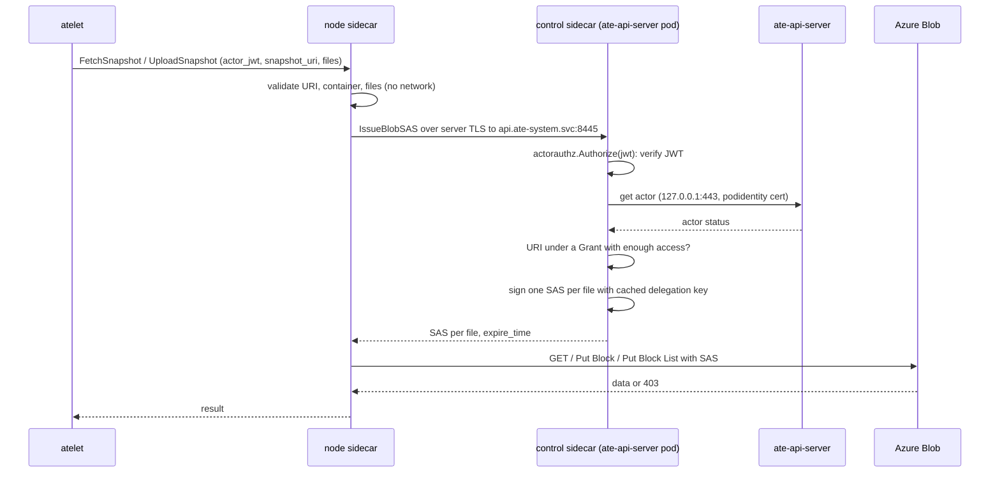

# Per-actor storage credentials

Status: design spike. Nothing here is implemented. The v1 transport was
decided on 2026-11-07 (Q2, Transport).

## Summary

- Today both sidecars hold `Storage Blob Data Contributor` on every snapshot
  container (README.md:166-185). A compromised node can read, overwrite and
  delete every actor's snapshots.
- Proposal: the control sidecar serves a credential exchange. For each
  transfer it calls substrate's `pkg/objectstore/actorauthz` `Authorize` and
  returns a per-blob user delegation SAS (`sr=b`) for each file in the
  request. The SAS is limited to the actor's grants and expires no later than
  the actor's JWT. The node sidecar loses its role on snapshot containers.
- Opt-in with `--credentials=per-actor`. The default, `identity`, keeps
  today's behavior.
- Prerequisite: a cluster that enforces NetworkPolicy (Azure NPM or Cilium).
  The exchange admits callers by NetworkPolicy plus the JWT, not by client
  certificate (Q2, Transport).

Security property: with `per-actor` on, a compromised node can read and write
only blobs under the prefixes of actors currently assigned to it in a transfer
state (read-only for the tag those actors were created from), each SAS for at
most its actor's remaining JWT lifetime (at most 1h); it cannot list or delete
blobs, reach any other actor's prefix, or get a credential once the actor
leaves the node; it can still read the configured asset containers.

- This holds once the node's snapshot-container role is removed (Q6 step 5).
- A node cannot mint a JWT for an actor it does not host. ate-api-server
  authenticates atelet by its pod certificate, checks that the actor is on
  the caller's node, and writes the caller's node into the token
  (substrate:cmd/ateapi/internal/workerservice/jwt.go:41-89).
- It does not depend on the exchange's transport:
  - ate-api-server mints the JWT for atelet, and atelet sends it only on
    transfer RPCs to the node sidecar in its pod
    (substrate:cmd/atelet/snapshot_transfer.go:58-88). The node sidecar sends
    it only to control, over server-authenticated TLS. Capturing one therefore
    means a compromised node or ate-api-server pod; the latter is out of scope
    (Risks).
  - `Authorize` re-checks the token's node and the actor's state on every
    exchange, so a JWT redeemed from anywhere else gets no more than the
    property above.
  - NetworkPolicy, and later mTLS, limit where a JWT can be redeemed. Neither
    changes which blobs it reaches.

## Citations

- Substrate paths: tag `v1.0.0` (`fd67f6204a7c287f658d080f6196ba1638744a10`),
  as `substrate:<path>:<line>`.
- Plugin paths: this repository at `5639af0`.
- Sidecar contract: `docs/reference/object-store-plugin-sidecar.md` in open
  substrate PR [#3651](https://github.com/agent-substrate/substrate/pull/3651)
  at `ec2065e5a600c580fa848e8d7f8dbf88d668f47f`, as `#3651:<line>`.
- Azure:
  - [Create a user delegation SAS](https://learn.microsoft.com/en-us/rest/api/storageservices/create-user-delegation-sas)
    (UDS doc).
  - [Azure Blob ABAC attributes](https://learn.microsoft.com/en-us/azure/storage/blobs/storage-auth-abac-attributes)
    (ABAC doc).

## What actorauthz gives us

- `Authorize(ctx, jwt)` returns a `Decision` with:
  - `ActorUID`.
  - `Grants`: each a `Prefix` URI ending in `/`, plus `ReadOnly` or
    `ReadWrite`.
  - `Expiry`, the JWT's `exp`. "A credential issued from a Decision must not
    outlive it." (substrate:pkg/objectstore/actorauthz/actorauthz.go:124-145)
- Grants:
  - `ReadWrite` on the actor's own prefix
    `<location>/atespaces/<atespace>/actors/<uid>`.
  - `ReadOnly` on each COMPLETED tag prefix the actor came from.
  - Source: substrate:internal/objectstoreplugin/actorscope/actorscope.go:75-120.
  - Prefixes are parsed without regard to scheme
    (substrate:internal/resources/validate.go:311-340), so `azblob://` URIs
    produce grants.
- Refusals:
  - It refuses a token whose actor is not in a transfer state or has left the
    token's node (substrate:internal/objectstoreplugin/actorauthz/actorauthz.go:218-227).
  - Transfer states are RESUMING, RUNNING, SUSPENDING and SUSPENDED
    (substrate:internal/resources/actorstate.go:19-35).
- Its gRPC error codes are part of its contract
  (substrate:pkg/objectstore/actorauthz/actorauthz.go:202-221).
- The package doc requires running in the ate-api-server pod with the
  podidentity cert. It also requires serving over TLS, admitting only atelet,
  calling Authorize per request and issuing nothing beyond Grants
  (substrate:pkg/objectstore/actorauthz/actorauthz.go:15-43).
- The JWT lives 1h (substrate:cmd/ateapi/internal/workerservice/jwt.go:39).
  atelet reuses a cached JWT while more than 5 minutes remain
  (substrate:cmd/atelet/worker_actor_jwt.go:34-38, 72-77). A transfer can
  therefore arrive with a JWT that has about 5 minutes left.

## Q1: credential shape

### Options compared

Least privilege is measured against Grants.

| Option | Least privilege vs Grants | TTL vs transfer | Revocation | Throughput |
| :--- | :--- | :--- | :--- | :--- |
| **A. Per-blob user delegation SAS (`sr=b`), recommended** | Tighter than Grants: only the named blobs; `r` for fetch, `w` for upload; no list or delete | Bounded by `Decision.Expiry`; see TTL risk | Expires on its own. Emergency: revoke all user delegation keys for the account, or remove the delegator's role, both with cache delay (UDS doc) | Node to Blob directly, same request pattern as today |
| B. Prefix SAS (`sr=d`, `sdd`) per Grant | Exactly Grants, one SAS per grant | Same as A | Same as A | Same as A |
| C. ABAC conditions on the node role | Static per role assignment; cannot vary by actor or node | No credential TTL; standing role | Delete the role assignment | Same as today |
| D. Proxy bytes through the control sidecar | Exactly Grants, enforced per request | No TTL issue: control's identity does the I/O | Immediate, every request is authorized | All snapshot bytes cross the network through the ate-api-server pods; bounded by their bandwidth and replicas |
| E. Container SAS (`sr=c`) | Whole container: every actor | Same as A | Same as A | Same as A |
| F. Service or account SAS | Signed with the account key; the plugin authenticates only with workload identity (cmd/azure-blob-objectstore-plugin/main.go:79) and holds no key | n/a | Rotate the account key | n/a |
| G. A managed identity per actor | Exact, but needs Azure control-plane writes on actor create plus federated credentials | Token TTL | Delete the identity | Same as today |

### Evidence

- Per-blob scope is possible because every node request names its files:
  `FetchSnapshotRequest.files` and `UploadSnapshotRequest.files` hold base
  names.
  - The plugin builds each blob name as `path.Join(prefix, file)`
    (internal/provider/provider.go:158, 208).
- The node uses only these store calls (internal/provider/provider.go:284,
  483, 503):
  - `Download` (one GET per file).
  - `StageBlock` and `CommitBlockList`.
- `List`, `Delete` and `DownloadRange` are used only by control-mode cleanup
  and copy (internal/provider/provider.go:220-281, 511-546).
- SAS permissions:
  - `r` covers content, properties and metadata; the sha256 check reads
    metadata from the GET.
  - `w` covers content and block list.
  - Effective rights are the intersection of `sp` and the delegator's RBAC
    (UDS doc).
- `sr=d` needs `sv` 2020-02-10 or later and `sdd` (UDS doc). The doc does not
  say whether `sr=d` works on an account without hierarchical namespace.
  `TODO(spike)` S1 below.
- ABAC:
  - The `blobs:path` attribute applies to read, write, add and delete, but not
    to List; `blobs:prefix` covers List.
  - Values have no container and no leading slash (ABAC doc).
  - Conditions are fixed per role assignment, and every node shares one
    identity federated to the `atelet` ServiceAccount (README.md:182-185). So
    ABAC cannot say "actors on this node".
  - It stays useful as a static fence (see Q3).

### Local experiment (Azurite)

Setup: Azurite 3.37.0, the image digest `hack/test-azurite.sh` pins, run with
`--oauth basic` over HTTPS. A Go client (azblob v1.8.0) does:
`GetUserDelegationCredential`, then
`sas.BlobSignatureValues{...}.SignWithUserDelegation`, then
`blockblob.NewClientWithNoCredential`.

| # | Request | Result |
| :--- | :--- | :--- |
| 1 | GET actor A's blob with `sr=b sp=r` for it | 200 |
| 2 | GET actor B's blob with A's SAS | 403 AuthorizationFailure |
| 3 | StageBlock with `sp=r` | 403 AuthorizationPermissionMismatch |
| 4 | StageBlock + CommitBlockList of new A blob with `sp=cw` | 200 |
| 4b | Same upload again (retry overwrite) | 200 |
| 5 | StageBlock to B's blob with A's `cw` SAS | 403 AuthorizationFailure |
| 6 | GET with `sp=cw` | 403 AuthorizationPermissionMismatch |
| 7 | GET with expired SAS | 403 AuthorizationFailure |
| 8 | GET under prefix with `sr=d sdd=4` | 403: Azurite does not support `sr=d` |
| 9 | GET missing blob with `sr=b sp=r` for it | 404 BlobNotFound |
| 10 | Upload new blob with `sp=w` only | 200 |
| 11 | Delete with `sp=cw` | 403 AuthorizationPermissionMismatch |
| 12 | List container with A's blob SAS | 403 AuthorizationFailure |

Limits of this evidence:

- Azurite accepts only `sr=c`, `b` and `bs` (Azurite
  `src/blob/authentication/BlobSASAuthenticator.ts:104-115` at 3.37.0), so
  rows 8 and S1 need live Azure.
- Azurite does not check RBAC, so the delegator intersection is untested.
- The delegation key Azurite returned did not verify Azurite's own signatures.
  Azurite derives the key at validation as HMAC(seed, skoid/sktid/skt/ske/sks/skv)
  (`src/blob/utils/utils.ts:425-442`). The experiment re-signed the SDK's
  string-to-sign with that derived key.
  - The string-to-sign layout matched the SDK's, but this is an emulator
    workaround, not proof the SDK signs correctly against Azure.
  - `TODO(spike)` S2 below.

### Recommendation

- Option A: one exchange per transfer RPC returns one SAS per file.
  - Fetch: `sp=r`. Upload: `sp=w`.
  - `spr=https`; never `l`, `d`, `c` or `t`.
  - `st` is now minus 5 minutes, the same skew the JWT allows
    (substrate:cmd/ateapi/internal/workerservice/jwt.go:81). `se` is
    `Decision.Expiry`.
- Option B is a later optimization if S1 shows it works on flat namespace. It
  would let a node cache one SAS per grant. A HNS-only `sr=d` is rejected
  because enabling HNS is a one-way account migration.
- Option D is rejected because snapshot bytes would flow through the control
  plane. It is the fallback if S3 shows SAS TTLs cannot cover transfers.

## Q2: the exchange RPC



### Wire format

- The port's protocol is the plugin's own (#3651:116-117).
- Use a plugin-owned gRPC service, not substrate's `CredentialExchange`. That
  RPC returns one access token per JWT
  (substrate:internal/objectstoreplugin/exchange/exchange.go:74-84) and does
  not take the URI and files a per-blob SAS needs.
- Request:
  - `actor_jwt` (`debug_redact`).
  - `snapshot_uri`.
  - `files`.
  - `access` (`READ` or `WRITE`).
- Response:
  - one SAS query string per file (`debug_redact`).
  - `expire_time`.
- The node builds each blob URL from its own `--account-url`, container and
  blob name, so a response cannot point the node at another host.
  - Logs carry neither JWTs nor SAS (`blobstore.RedactURL` already exists for
    URLs).

### Control-side checks, in order

1. `files` count and names pass the same validation the node uses
   (internal/provider/provider.go:620-656).
2. `Authorize(jwt)`. Return its error as is.
3. Parse `snapshot_uri` with `parseURI` (internal/provider/provider.go:670-701).
   - Find a Grant whose `url.Parse`d host equals the container and whose
     decoded path is a `/`-terminated prefix of the URI's decoded path.
   - `WRITE` needs `ReadWrite`. Otherwise return `PermissionDenied`.
4. Apply `--prefix` and `path.Join(prefix, file)`, exactly as the node does
   today.
5. Sign with the cached delegation key: `se = Decision.Expiry`. If the cached
   key ends before `se`, refresh it first.

### Delegation key cache

- One key per control replica:
  - validity 2h;
  - refreshed when less than 70 minutes remain, so every SAS (at most 1h) ends
    before its key;
  - one `Get User Delegation Key` call per replica about every 50 minutes.
- Key validity can be at most 7 days. A SAS cannot outlive its key's `ske`
  (UDS doc).
- After an emergency key revocation, restart the ate-api-server pods so
  control drops the revoked key.

### Transport

Decision (Anish, 2026-11-07): v1 follows the in-tree GCS exchange.

- Control serves server-only TLS with `servicedns`. The node verifies it with
  `servicedns-ca`, server name `api.ate-system.svc`, as #3651:108-117 allows.
- NetworkPolicy admits 8445 only from atelet pods (below). A cluster that
  enforces NetworkPolicy (Azure NPM or Cilium) is a prerequisite for
  `per-actor` mode and for e2e check 9.
- Control calls `actorauthz.Authorize` on the node-bound worker-for-actor JWT
  for every request.
- No client certificates in v1. Asking upstream to add atelet's `podidentity`
  to the node sidecar contract is the first follow-up after the last
  implementation PR (Implementation plan).
- Why: a captured JWT already implies a compromised node, so mTLS would not
  widen the security property (Summary).
- The actorauthz rules (substrate:pkg/objectstore/actorauthz/actorauthz.go:30-31)
  are met the way the in-tree exchange meets them: TLS by `servicedns`, "admit
  only atelet" by NetworkPolicy, `Authorize` per request, and no SAS beyond
  Grants (Q1).
- Without enforcement, any pod that reaches the Service reaches the exchange.
  Only a valid JWT still gets a SAS, so the property holds, but "admit only
  atelet" does not, and `per-actor` mode is unsupported there. The plugin
  cannot detect enforcement; e2e check 9 proves it.

Certificates already in the pods:

| Sidecar | Mounted | Source |
| :--- | :--- | :--- |
| control | `servicedns` serving bundle and `podidentity` identity bundle | #3651:88-106; substrate:manifests/ate-install/ate-api-server.yaml:169-173 |
| node | `servicedns-ca` trust bundle only | #3651:88-106; substrate:manifests/ate-install/atelet.yaml:246-247 |

- The atelet pod has a `podidentity` volume
  (substrate:manifests/ate-install/atelet.yaml:435-447), but only the atelet
  container mounts it (substrate:manifests/ate-install/atelet.yaml:368-369).
- The `podidentity` cert carries URI SAN
  `spiffe://cluster.local/ns/<ns>/sa/<sa>`
  (substrate:cmd/podcertcontroller/internal/podidentitysigner/podidentitysigner.go:116-137).
  - atelet's ServiceAccount is `atelet`
    (substrate:manifests/ate-install/atelet.yaml:145).
- NetworkPolicy:
  - It admits 8445 only from pods labeled `app: atelet` in `ate-system`: the
    rule has a `podSelector` and no `namespaceSelector`
    (substrate:manifests/ate-install/ate-system-networkpolicies.yaml:83-91).
  - The node sidecar runs in the atelet pod, so it matches.
  - NetworkPolicy is enforced only when the cluster runs a policy engine
    ([Kubernetes docs](https://kubernetes.io/docs/concepts/services-networking/network-policies/#prerequisites)),
    and an AKS install cannot assume one. Hence the prerequisite.
  - It admits by pod label, not by credential: anyone who can create a pod in
    `ate-system` can carry `app: atelet`.
- The in-tree exchange serves TLS 1.3 without client certificates and calls
  atelet proof "a later addition"
  (substrate:cmd/objectstore-plugin/exchange.go:86-98).

#### Alternatives considered, deferred

- mTLS with atelet's `podidentity`. Deferred to the first follow-up after the
  last implementation PR.
  - The node presents atelet's pod identity.
  - Control verifies it against the podidentity trust bundle and requires
    `spiffe://cluster.local/ns/ate-system/sa/atelet`.
  - Mounting it today works but is "not part of the contract"
    (#3651:156-164), so it is an upstream ask, not something this plugin
    assumes.
  - It would replace label-based admission with a credential and drop the
    NetworkPolicy prerequisite for "admit only atelet". It would not change
    what a compromised node reaches: that node holds atelet's key too.
- Node binding: control checks that the caller's node equals the token's
  node. Deferred until after mTLS, since it needs the client certificate.
  - The cert's PodIdentity extension carries
    `NodeName` (substrate:internal/substratex509/substratex509.go:50-58,
    78-107). ate-api-server already binds atelet callers to a node this way
    (substrate:cmd/ateapi/internal/ateletauth/ateletauth.go:43-79).
  - Binding the caller's node to the token's node needs a public parser and
    the token's node on `Decision`. Upstream ask.

### Caching and replay

- No SAS cache on either side in v1: one exchange per transfer RPC. Signing is
  a local HMAC.
- Per-exchange cost: one JWT verification, with keys cached by `actorauthz`,
  plus one actor Get over loopback.
- Replaying a captured JWT:
  - It needs network reach to 8445, which NetworkPolicy limits to atelet
    pods. The mTLS follow-up would also require atelet's key.
  - The exchange has no side effects, so a replay yields at most a SAS for the
    same actor's blobs until its `exp`.
- The SAS is a bearer token. TLS protects it in transit, and it is never
  logged.

### When Authorize refuses

- Control returns the `Authorize` status code unchanged, and never falls back
  to the control identity or to identity mode.
- The node maps codes the way the in-tree node does
  (substrate:internal/objectstoreplugin/credentials.go:77-88):
  - `NotFound` or `Aborted` becomes `FailedPrecondition`, since atelet reads
    `NotFound` as a missing snapshot object.
  - Other codes pass through.
- Storage 403 on a request:
  - Re-exchange once and retry, then return `PermissionDenied`. This matches
    substrate:internal/objectstoreplugin/credentials.go:122-144.
  - Blob 404 stays `NotFound` (Azurite row 9).
- Checks that fail locally (wrong scheme, unknown container, bad files)
  return `InvalidArgument` before any exchange. So AKS e2e checks 2 and 6
  keep their codes.

## Q3: node identity

| Identity | `identity` mode (today) | `per-actor` mode |
| :--- | :--- | :--- |
| node | Data Contributor on each snapshot container; Data Reader on asset-only containers (README.md:105-106, 166-185) | No role on snapshot containers. Data Reader on asset containers only if `--asset-containers` is set; without it, no Azure identity, no federated credential, no `AZURE_*` env |
| control | Data Contributor on each snapshot container | Same, plus `Storage Blob Delegator` at account scope |

- Control still needs Data Contributor for `CopySnapshot`, `CleanupSnapshot`
  and as the delegator: a SAS gets at most the delegator's rights (UDS doc).
- `generateUserDelegationKey` is granted only at account, resource group or
  subscription scope (UDS doc). A container-scoped role cannot sign, so add
  `Storage Blob Delegator` on the account, the built-in role the UDS doc
  names for that action.
- Assets:
  - A container may today serve both assets and snapshots
    (cmd/azure-blob-objectstore-plugin/main.go:150-151).
  - In `per-actor` mode, a node Reader role on such a container would read
    every snapshot.
  - Recommendation: refuse at node startup if `--asset-containers` and
    `--containers` overlap.
  - The contract already forbids overlapping locations (#3651:152-154). This
    is stricter, at container level.
  - Alternative for installs that must share a container: an ABAC condition
    on the Reader assignment that denies `blobs:path` matching the snapshot
    paths. Not recommended for v1, because it puts security in an operator-written
    expression.

Example role changes (docs only; these modify Azure, so run by an operator):

```bash
ACCOUNT_SCOPE="/subscriptions/<subscription>/resourceGroups/<resource-group>/providers/Microsoft.Storage/storageAccounts/<account>"
az role assignment create \
  --assignee-object-id <control-principal-object-id> \
  --assignee-principal-type ServicePrincipal \
  --role "Storage Blob Delegator" \
  --scope "$ACCOUNT_SCOPE"

# Remove the node's snapshot-container role by assignment ID (no Graph lookup).
az role assignment list --scope "$CONTAINER_SCOPE" --fill-principal-name false \
  --query "[?principalId=='<node-principal-object-id>' && roleDefinitionName=='Storage Blob Data Contributor'].id" -o tsv
az role assignment delete --ids <assignment-id>
```

## Q4: go.mod and plugin contract

The experiment ran in a scratch copy and was not committed:

- Today's pin: `go.ate.dev/substrate v0.6.1-0.20261028215204-893a45817bee`.
- `go get go.ate.dev/substrate@v1.0.0` succeeds.
- `actorauthz` was imported from a probe package; `go mod tidy`,
  `go build ./...`, `go vet ./...` and `go test ./...` passed.
- `pkg/objectstore/actorauthz/actorauthz.go`, the internal `actorauthz` and
  `actorscope` packages, and `api/objectstore/v1/objectstore.proto` are
  byte-identical at `v1.0.0` and at main `94e0a26ac`, which includes #3358.
- New indirect requirements (`go mod tidy` diff):
  - `cespare/xxhash/v2` v2.3.0
  - `distribution/reference` v0.6.0
  - `go-logr/logr` v1.4.4
  - `go-logr/stdr` v1.2.2
  - `opencontainers/go-digest` v1.0.0
  - `go.opentelemetry.io/auto/sdk` v1.2.1
  - `otelgrpc` v0.70.0
  - `otel`, `otel/metric` and `otel/trace` v1.45.0
  - `k8s.io/klog/v2` v2.140.0
  - `k8s.io/utils`
- The `go` directive is unchanged (1.27.0).
- Binary size: an earlier run at `94e0a26ac`, with `actorauthz` linked into the
  plugin binary, grew it from 22,586,114 to 25,031,522 bytes (+10.8%).
- Plugin contract:
  - `git diff 893a45817bee 94e0a26ac -- api/objectstore pkg/assetfetch` shows
    only copyright header changes. No RPC or field changed.
  - `actor_jwt` was already on both node requests.
- Recommendation: bump to the `v1.0.0` tag, not a pseudo-version.

## Q5: install impact

- Prerequisite: the cluster enforces NetworkPolicy (Azure NPM or Cilium).
  - On AKS, `az aks show -g <resource-group> -n <cluster> --query networkProfile.networkPolicy -o tsv`
    prints `azure` or `cilium`.
  - Without it, do not enable `per-actor` mode (Q2, Transport).
- Base manifests: nothing new for v1.
  - Port 8445, the `exchange` Service port, the NetworkPolicy,
    `ATE_API_ACTOR_JWT_ISSUER` and the control mounts already exist and stay
    (#3651:108-131; README.md:42-45).
  - The control sidecar uses them instead of ignoring them.
- `config/` component, `per-actor` overlay:
  - Control: add `--credentials=per-actor`, `--exchange-listen=:8445`,
    `--actor-jwt-issuer=$(ATE_API_ACTOR_JWT_ISSUER)` and the issuer CA and
    ate-api-server address, CA, server name and client bundle
    (`actorauthz.Config`,
    substrate:pkg/objectstore/actorauthz/actorauthz.go:71-102).
  - Node: add `--credentials=per-actor` and `--exchange-address=api.ate-system.svc:8445`
    with the `servicedns-ca` path.
  - Node, without asset containers: drop the `AZURE_*` env and the
    `azure-identity-token` volume from the node patch
    (config/kustomization.yaml:79-133).
- #3651 (`--storage-backend=external`):
  - It drops `ATE_STORAGE_BACKEND`, `AWS_*` and the transfer ServiceAccount.
  - It keeps the exchange port, the NetworkPolicy and the control mounts
    (#3651:88-131).
  - v1 needs nothing more from it. The `podidentity` mount for the node
    sidecar is the follow-up after the last implementation PR (Q2).
- AKS install guide (outside this repository): document the per-actor mode:
  - the NetworkPolicy prerequisite and how to check it;
  - the Delegator role;
  - removing the node's container role;
  - optionally deleting the node identity's federated credential;
  - disjoint asset containers.
- README: changes wait until the README rewrite lands (PR 7 below).

## Q6: migration

Prerequisite: the cluster enforces NetworkPolicy (Q5). Check it before step 3.

Order:

1. Bump substrate (no behavior change).
2. Ship the code with `--credentials=identity` as default. Both modes work
   with today's roles.
3. Operator grants control `Storage Blob Delegator`, then switches the control
   sidecar to `per-actor` (serves the exchange). Nodes in `identity` mode still
   work.
   - Before step 4, run e2e check 9 against the live exchange. If it fails,
     stop: NetworkPolicy is not enforced.
4. Operator switches nodes to `per-actor`. A DaemonSet rollout means mixed
   nodes for a while; both modes are valid against the same blobs.
5. Operator removes the node's snapshot-container role. Only now does the
   security property hold. Rollback: re-add the role, then flip nodes back.

- The flag is per sidecar. Control in `identity` mode does not serve 8445, so
  a `per-actor` node against it fails closed: exchange `Unavailable`.
- `actorauthz.New` fails at start for a bad issuer CA. Other fetch errors make
  `Authorize` return `Unavailable`
  (substrate:pkg/objectstore/actorauthz/actorauthz.go:154-161). Start-up
  readiness should not depend on ate-api-server, which is lazy.

### AKS e2e extension

The e2e cluster must enforce NetworkPolicy (Q5). Check 9 fails without it,
by design.

Existing checks 1-6 run unchanged in `per-actor` mode:

1. Happy path: private assets, microVM, actor boot and suspend.
2. `gs://` URI gives `InvalidArgument`; an anonymous asset read.
3. Missing blob gives `NotFound`.
4. Wrong sha256 gives `FailedPrecondition`.
5. Snapshot location used as an asset gives `PermissionDenied`.
6. Another storage account gives `InvalidArgument`.

New checks:

7. Isolation. Two actors A and B, in different atespaces, both suspended once.
   - Control check: through the node sidecar's socket, send `FetchSnapshot`
     with A's JWT and B's snapshot URI. Expect `PermissionDenied`.
   - Storage check: exchange A's JWT for A's snapshot files, then use A's SAS
     on B's blob name. GET and Put Block both expect 403.
   - Use A's `r` SAS: Put Block expects 403; list the container expects 403.
   - Getting A's JWT outside atelet is S6.
8. Node departure: suspend A on node 1 and resume it on node 2, then exchange
   node 1's cached JWT for A. Expect `PermissionDenied`.
9. Caller admission (NetworkPolicy):
   - Positive control: from an ephemeral debug container in an atelet pod
     (it shares the pod's network and labels), a TLS handshake with
     `api.ate-system.svc:8445` succeeds.
   - From a pod in `ate-system` without `app: atelet`, and from a pod labeled
     `app: atelet` in another namespace, the TCP connection fails (timeout or
     refused) within 10 s.
   - A TLS handshake failure variant comes with the mTLS follow-up.
10. Standing access, read-only:
    `az role assignment list --scope "$CONTAINER_SCOPE" --fill-principal-name false --query "[?principalId=='<node-principal-object-id>']" -o tsv`
    returns nothing.
11. Cross-node move: the existing suspend on A, resume on B scenario passes in
    `per-actor` mode.

## Risks and upstream asks

- TTL versus transfer length:
  - `se = Decision.Expiry` can be about 5 minutes away (atelet margin, above).
  - Each Put Block is a separate request, so an upload that runs past `se`
    fails, and re-exchanging the same expired JWT cannot help.
  - atelet's comment says the JWT "only has to be valid when the node plugin
    exchanges it, not for the duration of a transfer"
    (substrate:cmd/atelet/worker_actor_jwt.go:35-37).
  - The in-tree exchange returns the GCS token's own expiry
    (substrate:internal/objectstoreplugin/exchange/exchange.go:83) and serves
    cached tokens with at least 20 minutes left
    (substrate:internal/objectstoreplugin/credential/credential.go:28-32).
  - These conflict with the `Decision.Expiry` rule.
  - Ask upstream to either raise atelet's refresh margin above the longest
    transfer, or define a bounded grace past `exp` in the actorauthz contract.
- Caller admission is NetworkPolicy in v1 (Q2 decision). It admits by pod
  label, and only on a cluster that enforces it, hence the prerequisite and
  check 9. mTLS with `podidentity` is the first follow-up after PR 7.
- Node binding: needs the token's node on `Decision` plus a public PodIdentity
  parser (Q2).
- Revocation lag: an issued SAS lives until `se` (at most 1h). Account-wide
  key revocation is coarse and cached (UDS doc). Same window as the in-tree
  GCS token.
- Compromised control sidecar: it is as trusted as ate-api-server by
  construction (substrate:pkg/objectstore/actorauthz/actorauthz.go:23-28)
  and holds Data Contributor plus Delegator. That is out of scope.

## TODO(spike)

These need live Azure: a throwaway storage account, no production data, run
by an operator. Each uses the azblob v1.8.0 SDK with `DefaultAzureCredential`
for an identity holding Data Contributor on one container and Delegator on the
account.

- TODO(spike): S1, does `sr=d` with `sdd` scope a user delegation SAS on a flat-namespace (HNS off) account?
  - Upload `p/atespaces/t/actors/A/x` and `p/atespaces/t/actors/B/x`.
  - Sign `sr=d`, `Directory: "p/atespaces/t/actors/A"`, `sp=r`.
  - GET both blobs.
  - Pass: 200 for A and 403 for B. Repeat with `sp=w` Put Block.
- TODO(spike): S2, does an unmodified azblob v1.8.0 `SignWithUserDelegation` SAS verify on Azure?
  - Same program as the Azurite run, without the re-sign step.
  - Rows 1-7 and 9-12 must match the Azurite table.
- TODO(spike): S3, does a GET that starts before `se` finish after it, and how long do snapshot transfers take?
  - Sign `sp=r`, `se = now + 2m` for a 20 GiB blob and download it at
    throttled speed, so it takes over 5 minutes.
  - Record whether the body completes.
  - Record p99 FetchSnapshot and UploadSnapshot durations from the AKS e2e
    logs for the largest snapshot.
- TODO(spike): S4, how long after Revoke User Delegation Keys does a previously valid SAS start failing?
  - Sign `sp=r`, `se = now + 1h`, call `revokeUserDelegationKeys`, and GET
    every 10 s until 403.
  - Record the delay, and whether a new key works at once.
- TODO(spike): S5, does atelet retry a transfer that fails with `PermissionDenied` or `FailedPrecondition` from an expired SAS, and with a fresh JWT?
  - Read the atelet transfer helpers and the suspend and resume controllers.
  - Then force `se = now + 30s` in a dev build and suspend a large actor on
    kind.
- TODO(spike): S6, how does the e2e harness get a worker-for-actor JWT for actor A?
  - Candidate: a debug container in the atelet pod that mounts `podidentity`
    and calls `MintWorkerActorJwt`
    (substrate:cmd/ateapi/internal/workerservice/jwt.go:41).
  - Try it on kind first. Pass: a JWT the exchange accepts for A.
- TODO(spike): S7, does `sduoid` binding add anything?
  - It binds a SAS to an Entra object ID, and the caller must also present a
    matching bearer token (UDS doc).
  - The node would need its own Entra identity again, which `per-actor` mode
    removes.
  - Decide after S1-S3. The expected answer is no.

## Implementation plan

Each PR is small and builds and tests on its own.

1. `chore(deps)`: bump substrate to `v1.0.0`. No behavior change.
2. `feat`: SAS signer plus delegation key cache in `internal/sas`.
   - Unit tests against a fake key source.
   - Azurite test for `sr=b` `r` and `w`, gated on S2 for the re-sign question.
3. `feat`: exchange proto and control-mode server behind
   `--credentials=per-actor`.
   - Authorize, grant matching and file validation.
   - Table tests for every Authorize code and for grant prefix edges: sibling
     UID prefix, percent-encoding, `--prefix`.
4. `feat`: node-mode SAS store and exchange client.
   - Re-exchange once on 403.
   - `NotFound`/`Aborted` mapped to `FailedPrecondition`.
   - Startup refusal for overlapping asset and snapshot containers.
5. `feat(config)`: `per-actor` kustomize overlay (flags, mounts, node identity
   removal).
6. `test(e2e)`: AKS checks 7-11, run against the AKS harness on a cluster
   that enforces NetworkPolicy.
7. `docs`: README section for `per-actor` mode, after the README rewrite
   merges. AKS install guide update.

First follow-up, after PR 7: ask upstream to add `podidentity` to the node
sidecar contract. Once it lands, a plugin PR adds mTLS (Q2, Alternatives
considered, deferred) and the TLS handshake failure variant of check 9.

Upstream, in substrate:

- `podidentity` in the node sidecar contract: the first follow-up above.
- The token's node on `Decision` plus a public PodIdentity parser.
- A resolution of the JWT refresh margin versus `Decision.Expiry`.
